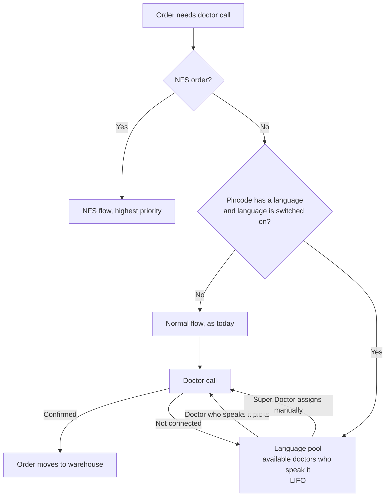

# PRD: Project South — Language-Based Doctor Assignment

**Feature:** Assign doctor calls in South pincodes to doctors who speak the customer's language
**Status:** Draft for review
**Version:** v1
**Last updated:** 29 Sep 2026
**Owner:** Swapnil Singh

---

## 1. Overview

Orders from South India drop off more than the rest of the country before they reach the warehouse. A big reason is the doctor's call. Today a doctor is picked without looking at language, so a customer in Madurai who speaks only Tamil can get a doctor who speaks only Hindi. The call connects, but the consultation doesn't happen, and the order is lost.

With this feature, every doctor will have one language they can consult in, and every South pincode will have a language. When an order from a South pincode needs a doctor call, doctors who speak that pincode's language get it first.

Nothing changes for orders outside South, for NFS orders, or for how Super Doctor manually assigns orders.

---

## 2. Problem

South (excluding Bangalore) vs the rest of India, August:

| | South | Non-South |
|---|---|---|
| FTC orders placed | 24,483 | 1,71,073 |
| FTC discarded | **27.83%** | 23.40% |
| FTC delivered | **51.23%** | 59.07% |
| NFTC discarded | 6.31% | 6.49% |

The gap is in first-time customers. They almost always need a doctor call, and that is where the language mismatch happens.

South FTC doctor confirmation (order placed → reached warehouse) is **72.04%**, against **76.49%** for the rest of India.

If we close this gap: **+1,091 more confirmed orders a month, +774 delivered orders a month (about +25 a day)**. OP2OD improves by **+3.16pp** for South FTC and **+0.96pp** for all South orders.

---

## 3. Goals

- Get South customers a doctor who speaks their language.
- Bring South FTC doctor confirmation up to the rest of India (72.04% → 76.49%).
- Don't slow down or block any order. If a matching doctor isn't available, the order moves on as it does today, order will get manually assigned by ops
- Keep the current doctor experience and order priority (LIFO) as they are.

---

## 4. Out of Scope

- **Pincodes with a mix of languages.** In this release each pincode gets one language. Pincodes without a clear language are left blank and follow the normal flow.
- **Asking or remembering the customer's own language.** The language comes from the pincode only.
- **Handing a call over to another doctor mid-call** after a language mismatch.
- **Alerts or nudges** to doctors or Super Doctor when language orders are waiting.
- **Chat, questionnaire or translation-based consultations.**
- **NFS orders.** They keep their current flow and highest priority.
- **Non-South languages.** The setup supports them later, but only South is switched on now.

---

## 5. How It Works — Simple Rules

### 5.1 Doctor languages
- Each doctor has **one** language mapped, the language they can **consult** in (not just chat in), e.g. `TAMIL`.
- Doctor Ops provides this mapping. Tech loads it on the doctor record.
- A doctor with no language mapped gets normal orders exactly as today.

### 5.2 Pincode language
- Each South pincode has one language: Tamil, Telugu, Kannada or Malayalam.
- No pincode in the pincode language mapping→ no language routing, so the order follows the normal flow.

### 5.3 Which orders go to the language pool
An order goes to the language pool only if **all** of these are true:
1. It is **not** an NFS order. NFS orders always keep their highest priority and never enter the language pool.
2. Its delivery pincode has a language.
3. That language is **switched on**, i.e. we have enough doctors who speak it.

Otherwise the order goes to the normal flow as it does today.

### 5.4 Who gets a language pool order
- Only doctors who speak that language **and** are marked available.
- For these doctors, language pool only goes to them
- Within the language pool, orders are picked in the same order as today: LIFO.

### 5.5 Starvation Risk – Interim Operational Handling

Currently, we are accepting the starvation risk and handling it through an operational workaround.
- Ops will monitor pending/unassigned orders and manually assign them to available online doctors.
- To support this process, we need to build an Ops portal/page that provides visibility into all currently available online doctors, along with relevant filters.
- The Super Doctor/Ops team can use this portal/page to identify and assign an order to an available doctor.
- Today, Ops manually calls individual doctors to confirm whether they are online/available and then assigns the order accordingly.
- The proposed portal should reduce this manual dependency by providing a centralized view of online/available doctors and enabling faster order assignment.

**Future scope:** Automate doctor availability and order assignment to reduce manual intervention and further mitigate starvation risk.

### 5.6 Switching a language on or off
- A language is switched on when there is pincode and and language mapping available
- If a language is switched off, its orders skip the language pool and go to the normal flow.

### 5.7 Super Doctor manual assign
- Works exactly as today. Super Doctor can assign any order to any doctor.
- No language check. The order moves ahead in the flow as usual.
- Visibility of Dr available/ onilne to manually assign, with filter of NFS, Language, Normal etch

---

## 6. User Journeys

**Customer in Madurai (Tamil pincode)**
1. Places an order that needs a doctor call.
2. The order is tagged Tamil and goes to the Tamil pool.
3. An available doctor who speaks Tamil picks it up and calls.
4. The consultation happens in Tamil, the order is confirmed, and it moves to the warehouse.
5. If no doctor who speaks Tamil is free the ops/Super Doctor admin will manually assign the order to the available Dr,  the order goes to the normal flow and any doctor calls, same as today.

**Doctor mapped to Tamil**
1. Clicks to get the next order.
2. Get a Tamil pool order first, if one is waiting (LIFO).
3. If no Tamil orders are waiting nor order till it gets manually assigned

**Doctor who speaks only Hindi and English**
- No change. Gets normal orders

**Super Doctor**
1. Opens the pending view and sees the language summary. For example: *"Telugu: 5 Pending, oldest 1h 20m, 0 doctors available"*.
2. Decides whether to wait or step in.
3. Checks on the Available doctor page to get online doctor and manually assign the Doctor
4. Super Doctor can manually assign the order to any doctor. There is no language check, and the order moves ahead as usual.

**Timing examples (operational hours 08:00–22:00)**

| Order comes in | Doctors who speak the language | What happens |
|---|---|---|
| 11:00 | One available | Assigned within 15 minutes |
| 11:00 | All busy until 11:40 | Assigned at 11:40 |
| 11:00 | None available all day | Manually assigned by Ops |
| 21:30 | None available | Manually assigned by Ops |

---

## 7. Screen Changes

### Super Doctor — pending order view
The following changes are required in the Super Doctor portal to support manual order assignment and improve visibility:

**Language Pool Order Visibility**
- Add visibility of orders coming from the Language Pool.
- Display a language tag against each order to clearly indicate the required language.

**Order List**
- Add/extend the order list to include Language Pool orders along with the existing orders.
- Enable Super Doctors/Ops to identify the language requirement before assigning an order.

**Online Doctor Availability**
- Add a dedicated page/view to display all currently online/available doctors.
- Provide relevant filters to help identify doctors based on availability and other applicable attributes.
- Allow Super Doctors/Ops to use this view to identify and assign orders to available doctors.

**Objective:** Provide Super Doctors with a single view of pending Language Pool orders + required language + available online doctors, enabling faster and more efficient manual order assignment.

### Doctor portal
No Change for Doctor Portal

---

## 8. Edge Cases

- **NFS order from a South pincode:** follows the NFS flow with highest priority. Never goes to the language pool.
- **Pincode with no language (blank or or not in table):** normal flow.
- **Doctors who speak the language are all busy:** the order waits in the pool, and the next one to free up gets it. Or gets manually assigned by Ops to available Doctor
- **No doctor who speaks the language is available,** Super Doctor can assign manually any time.
- **More language orders than doctors can handle:** Order waits in the pool or Super Doctor can assign manually.
- **Call not connected / doctor doesn't call in time:** The order goes back to the language pool.
- **Customer in a South pincode doesn't speak the local language:** accepted for this release. Most doctors who speak the local language also speak English or Hindi.

---

## 9. Flow Diagram

---

## 10. Metrics & Instrumentation

### Metrics

| Metric | Definition | Baseline | Target |
|---|---|---|---|
| South FTC doctor confirmation | FTC orders reaching warehouse ÷ FTC orders placed, South | 72.04% (Aug) | 76.49% |
| South OP2OD | Delivered ÷ placed, South | FTC 51.23% (Aug) | +3.16pp FTC, +0.96pp all South |
| Match rate | Language pool orders confirmed by a doctor who speaks the language ÷ all language pool orders | New | Track from pilot |
| Guardrail: Non-South doctor confirmation and time to first call | Same as today | Current | No drop |
| Guardrail: South cancellation | Cancelled ÷ placed, South | FTC 11.88% | No rise |

---

## 11. Rollout

| Stage | What | Move to next stage when |
|---|---|---|
| 1. Data ready | Doctor languages and South pincode list loaded | Data checked, enough doctors per language |
| 2. Pilot | Switch to one South language. Eligible orders go through the language pool | Confirmation clearly better than control, guardrails hold |
| 3. South rollout | Switch on the other South languages one by one | Each language meets the doctor minimum |

---

## 12. Open Items

1. **Minimum number of doctors per language** before switching it on (per shift). Needs Doctor Ops' current headcount by language.
2. **To confirm:** doctors who speak the language get language pool orders before normal orders, and the pool uses the same LIFO order as today.
3. **Pilot language:** which South language goes first. Suggest the one with the highest order volume and enough doctors. - TBD
4. **Call-back time shown to the customer.** The call-back card shows "doctor will call in 5 minutes" before 10 PM. To keep the card as-is for the pilot.

---

## 13. Operational Note

- Starvation risk is accepted for the initial rollout. During this phase, pending/unassigned orders will be monitored and manually assigned by Ops/Super Doctors to available online doctors.
- The Super Doctor portal will provide visibility into pending Language Pool orders (with language tags) and currently available online doctors to support this manual assignment process.
- Automation of doctor availability and order assignment can be considered as a subsequent phase.
