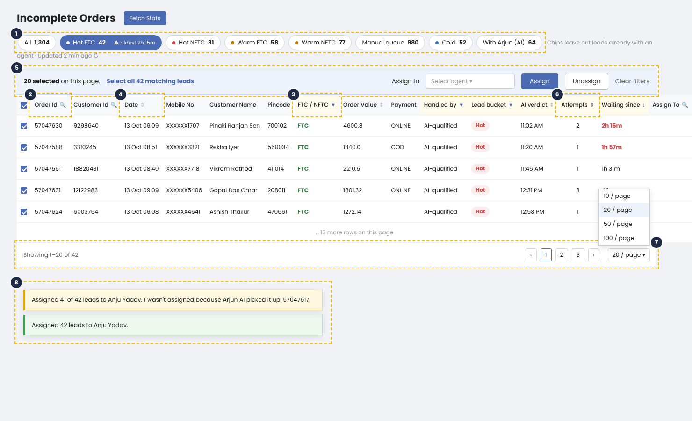
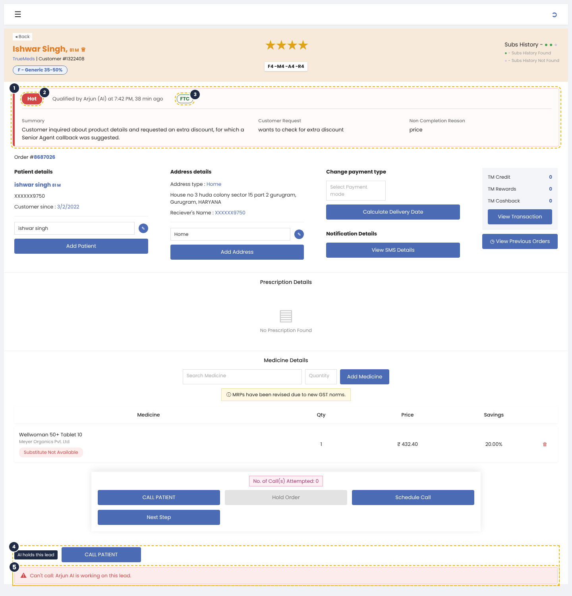

# AI Lead Context on the ACOM Portal

**Author:** Apurva Shetty (Product) · **Status:** Draft v2, for review · **Owner team:** ACOM
**Parent PRD:** AI-led Lead Qualification PRD (Confluence PROD · 2023260174).

---

## 1. Summary

The AI now calls customers and marks each lead Hot, Warm or Cold. The ACOM portal shows none of this yet. Team leads (TLs) can't tell which leads the AI has worked, and agents call without knowing what the customer told the AI.

This PRD brings the AI's result onto two screens: the **Incomplete Orders** listing that TLs use to assign leads, and the **lead page** agents see when they pick up a lead.

It covers the agent user story in Parent PRD §7: the agent should know the AI qualified the lead, how interested the customer is, and what they said.

## 2. The problem

- **Agents start every call from zero.** Ring sends us a summary of the call, what the customer asked for, and why they didn't order. Agents never see any of it.
- **TLs can't see what the AI is doing.** The listing doesn't show who handled a lead, how interested the customer is, or how long a Hot or Warm lead has been waiting. In the POC, 42% of Hot and Warm leads went stale before an agent attempted them (Parent PRD §2).
- **TLs can assign a lead the AI is still calling.** The backend blocks it, but the portal doesn't tell the TL why.
- **The listing is too long to use.** It shows every incomplete order, about 1,100 pages at 20 per page. The Status column says "INCOMPLETE ORDER" on every row, and the rows-per-page option doesn't work.

## 3. Phases

| Phase | What ships |
| --- | --- |
| 1 | All changes in §4 and §5 |

## 4. Listing page (Incomplete Orders, TL view)

### 4.1 Which leads are listed

The listing shows only leads whose cart has been inactive for more than 30 minutes and less than 24 hours.

Hot and Warm leads are the exception. They stay for 24 hours from the AI's verdict, even if that runs past the cart window (Parent PRD §5).

Closed leads are not listed: retries used up, over the call limit, stale, or an invalid number. Leads the AI is working on are listed, so the TL can see them (§4.5).

### 4.2 Quick chips

A row of chips sits above the table: All · Hot FTC · Hot NFTC · Warm FTC · Warm NFTC · Manual queue · Cold · With Arjun (AI).

Each chip shows how many leads in it are still waiting for an agent. "With Arjun (AI)" shows how many the AI is working on. Clicking a chip shows exactly those leads. Clicking it again goes back to All.

If a Hot or Warm lead has waited more than 2 hours, its chip turns red and shows the wait. That's the same point at which the AI stops taking new leads (Parent PRD §6), so the TL knows to push these first.

Counts refresh when the page loads, after every Assign or Unassign, and when the TL clicks refresh. They don't refresh on their own, so rows don't move while the TL is ticking leads.

### 4.3 Columns

The Status column goes. FTC / NFTC takes its place.

Five new columns:

- **Handled by:** With AI, AI-qualified, or Human.
- **Lead bucket:** Hot, Warm or Cold, as Ring sent it. Blank for leads only a human has handled.
- **AI verdict:** when the AI's result came in.
- **Attempts:** total number of call attempts made on this lead (by AI or human).
- **Waiting since:** how long an unassigned Hot or Warm lead has waited. Turns red after 2 hours.

The TL can search, filter and sort these columns:

| Control | Columns |
| --- | --- |
| Search | Order Id, Customer Id, Assign To |
| Filter | FTC / NFTC, Handled by, Lead bucket |
| Sort | Date, Order Value, AI verdict, Attempts, Waiting since |

When a Hot or Warm chip is selected, the list sorts by longest wait first.

Rows per page works: 10, 20, 50 or 100, with "Showing x–y of N" at the bottom.

### 4.4 Selecting and assigning

The old Assign/Unassign box and Assign Filter at the top of the page are removed. Column filters do the filtering, and assigning moves into a bar that appears when the TL ticks rows.

How a TL assigns leads:

1. Filter the list, using a chip or the column filters.
2. Tick the leads to assign. To pick every lead in the filtered list, not just this page, click **Select all N matching leads**.
3. In the bar, pick an agent and click **Assign**. **Unassign** works the same way.
4. The bar shows what happened, for example: "Assigned 41 of 42 leads to Anju Yadav. 1 wasn't assigned because Arjun AI picked it up: 57047617."

Changing a chip or filter clears the ticked leads, so leads the TL can no longer see are never assigned by mistake.

### 4.5 Leads the AI is working on

The AI holds a lead from the moment we send it to the AI until its result comes back. That includes retries and callbacks the AI has scheduled. Leads marked Outcome unknown (Parent PRD §12) are held the same way until a result arrives.

While the AI holds a lead:

- Assign To shows **Arjun (AI)**, and the row is greyed out.
- The TL can't tick it, assign it or unassign it. Hovering shows: "Arjun AI is working on this lead. You can assign it once the AI is done."
- Select all skips these leads and says how many it skipped.
- The TL can search for Arjun (AI) in Assign To, but can never pick it as the agent to assign to.

If the AI picks up a lead in the moment between the TL ticking it and clicking Assign, the backend turns it down and the result message names that lead (§4.4).

## 5. Lead page (agent)

### 5.1 AI box

When the AI has a result for a lead, a box appears under the header, above the order number. The agent reads it before pressing CALL PATIENT. Leads only a human has handled don't get the box.

The box shows:

- The lead bucket as a chip (Hot, Warm or Cold), with a matching coloured edge: red, amber or blue. The chip always carries the word, so it doesn't rely on colour alone.
- When the AI qualified the lead, for example "Qualified by Arjun (AI) at 7:42 PM, 38 min ago".
- FTC or NFTC.
- Ring's **Summary**, **Customer Request** and **Non Completion Reason**, with Ring's field names and exactly what Ring sent.

If Ring left a field blank, it shows "NA". We don't show Ring's Customer Name or Order ID, since the page already has ours. If the AI called more than once, the box shows its latest result.

### 5.2 CALL PATIENT when the AI holds a lead

When the AI is currently holding a lead, clicking CALL PATIENT does not place the call. Instead, an inline error appears: "Can't call: Arjun AI is working on this lead."

Engineering to choose the simpler implementation: either keep the button active and show the error on click, or disable the button and show the reason next to it. The outcome for the agent is the same either way.

Nothing else on the page changes.

## 6. Scope

**In:** everything in §4 and §5.

**Out:**

- Do-not-call, both the agent button and blocking calls. It's tracked separately in PPE-284.
- Retiring the Hold button.
- Any change to how leads are prioritised or how agents pick up leads.
- A kill switch or settings on the portal. Engineering handles these on request (Parent PRD §6).
- Call recordings or transcripts on the lead page.

## 7. Decided vs open

**Decided**

- We show Ring's fields as Ring sends them and add none of our own.
- Leads the AI is working on can't be assigned or unassigned from the portal, and the portal says why.
- Chip counts leave out leads already assigned to an agent.

**Open** *(owner in brackets)*

- Is there a limit on how many leads "Select all matching" can assign in one go? [Engineering]
- Does the listing already limit itself to the 30-minute to 24-hour window in §4.1? We believe it doesn't. [Engineering]
- For §5.2: disable CALL PATIENT or keep active and error on click — whichever is simpler to build. [Engineering]

**Accepted, not blocking**

- A TL can't take a lead back from the AI. The global kill switch is the only way to stop it.
- Non Completion Reason is free text, so the TL can't filter by it.

**Risk** *(Business)*: the bot tells customers a senior agent can look for a discount. If agents have nothing extra to offer, price-objection leads will convert less than the AI's read suggests.

## 8. How we'll know it worked

- Fewer Hot and Warm leads go stale, reaching the Parent PRD §10 target.
- The AI and an agent never call the same customer at the same time (Parent PRD §10 safety gate).
