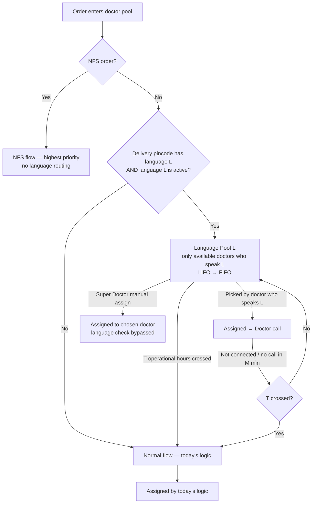

# Project South — Allocation Logic (Steps 3–6)
**Date:** 2026-09-29. Final spec as of narration Entry 13 (drafts in Entries 11–12).
**Status:** Final for review. Two small confirmations are in §9.

**Inputs (provided by the business, loaded by Tech)**
- `doctor_languages` on each doctor, e.g. `TAMIL,ENGLISH,HINDI`
- South `pincode → language` (one language per pincode; blank = not routed)
- Existing: doctor **availability flag**, **operational hours**, NFS classification, and today's **LIFO → FIFO** ordering

---

## 1. Design principles (locked)
1. **Keep today's experience.** Ordering stays **LIFO → FIFO** as today. Project South only decides *which doctors* can take a language order during its first T.
2. **NFS orders are never affected.** They keep the highest priority and never enter the Language Pool.
3. **Language matching is time-limited.** After T, the order goes back to the **normal flow** as a normal order.
4. **Super Doctor can always override.** Manual assign ignores language.
5. **Operational hours are respected.** T counts only during operational hours.

---

## 2. Order flow

### Step by step
1. **NFS check.** If the order is NFS → NFS flow, highest priority, **no language routing**. Stop.
2. **Language check.** Look up the delivery pincode → language L.
   - No language → **normal flow**. Stop.
   - L is **not active** (R7: no doctors, or below the go-live minimum) → **normal flow**. Stop.
3. **Language Pool.** The order is tagged L and enters the Language Pool for L.
4. **Who can take it:** only doctors who **speak L** *and* whose **availability flag = available**.
5. **Order within the pool:** **LIFO → FIFO**, exactly as today's logic.
6. **Release.** If the order isn't assigned within **T** (counted in operational hours only), it is **released to the normal flow** and treated as a normal order from then on. The tag stays on the order for reporting only.
7. **Retries.** If the call isn't connected, or the doctor doesn't call within M minutes:
   - T not yet crossed → back to the Language Pool.
   - T crossed → normal flow.
   - T is counted from the order's **first** entry into the pool and doesn't restart.
8. **Super Doctor manual assign** at any point → goes to the chosen doctor, **language check bypassed**, and continues in the flow as today.

---

## 3. Doctor side: what each doctor gets
| Doctor | Orders they can get, in priority order |
|---|---|
| NFS-eligible doctor | NFS orders first, as today (highest priority) |
| Doctor who speaks L (available) | 1. **Language Pool L** orders (LIFO → FIFO) → 2. Normal flow orders (LIFO → FIFO, as today) |
| Doctor with no South language | Normal flow only, exactly as today |

*Language Pool orders come before normal orders for doctors who speak L because a Language Pool order can **only** be taken by them during T, while normal orders can be taken by anyone. See confirmation C1 in §9.*

---

## 4. Release & operational hours (final)
| # | Rule |
|---|---|
| **R1** | **T counts only during operational hours** (e.g. 08:00–22:00, as configured today). Outside those hours the clock pauses. |
| **R2** | **T = 2 operational hours** (configurable, can be set per language). Counted from first entry into the pool. It doesn't restart on retry. |
| **R3** | **Release = move to the normal flow.** The order is treated exactly like a normal order from then on, with no special language priority. The tag is kept for reporting. |
| **R4** | Once released, the order **never goes back** to the Language Pool. |
| **R7** | **Condition:** a language with no doctors, or below the go-live minimum, is **not active**. Its orders skip the Language Pool and go to the normal flow from the start. |
| **R8** | Record the release time and reason (`auto_T`) on the order. |

**Why operational hours matter:** an order placed at 21:30 uses 30 minutes of T before close. The clock resumes at opening, so doctors who speak L get the remaining 1.5 hours in the morning before the order is released. Without the pause, overnight orders would be released before any doctor who speaks L logs in.

### Timelines (T = 2 operational hours, operational hours 08:00–22:00)
| Order enters pool | Doctors who speak L | Outcome |
|---|---|---|
| 11:00 | One available | Assigned within minutes (matched) |
| 11:00 | All busy until 11:40 | Assigned at 11:40 (matched) |
| 11:00 | None available all day | **Released to normal flow at 13:00.** Any doctor takes it as today. Super Doctor could have assigned it manually earlier. |
| 21:30 | None available | 30 min used before close. Resumes 08:00. **Released at 09:30** if no doctor who speaks L has taken it. |
| 23:00 (outside operational hours) | — | Clock starts at 08:00. Released at 10:00 if needed. |

---

## 5. "No doctor available": every case
| # | Situation | What happens |
|---|---|---|
| N1 | Doctors who speak L are available but all busy | The order waits in the Language Pool. The next doctor who speaks L gets it (LIFO → FIFO). Released at T if still waiting. |
| N2 | Doctors who speak L exist but none are available | The order waits. **Super Doctor sees it in the pending view** and can manually assign (bypassing language) if needed. Otherwise released at T. |
| N3 | Outside operational hours | Clock paused. Doctors who speak L get first claim when operational hours resume. |
| N4 | More L orders than doctors who speak L can handle | Orders past T are released to the normal flow one by one. Super Doctor can manually assign any of them. |
| N5 | No doctor speaks L, or L is below the go-live minimum | R7: language not active. Normal flow from the start. |
| N6 | No doctor of any language is available | Same as today |
| N7 | Doctor who speaks L is available but not picking orders | Super Doctor sees the pending orders and can manually assign |
| N8 | Order released and taken by a doctor who doesn't speak L | Allowed (normal flow). Recorded as *unmatched* for the match-rate metric. |

---

## 6. Super Doctor portal
### 6.1 Pending view: visibility
The existing pending-order view is extended so Super Doctor can see language pendency:

| Addition | Detail |
|---|---|
| **Language** column | e.g. "Tamil", blank for normal orders |
| **Pool status** column | Language Pool / Normal (released orders show as Normal, with the language still visible) |
| **Time in Language Pool** column | Operational-hours time used out of T |
| Filters | By language and pool status |
| **Language summary strip** | Per language: pending in pool, oldest wait, **doctors who speak L who are available now** (from the availability flag) |

Example strip:

| Language | Pending in pool | Oldest wait | Doctors who speak L available |
|---|---|---|---|
| Tamil | 12 | 1h 10m | 3 |
| Telugu | 5 | 25m | 0 |

→ Super Doctor sees at a glance that Telugu has pending orders and nobody available, and can step in.

### 6.2 Manual assign: bypass
- Works **as today**. Super Doctor picks any doctor.
- **No language check, no warning, no reason required.**
- The order leaves the Language Pool and moves ahead in the flow (M-minute call window, retries, etc. as today).
- Record `assigned_by = super_doctor` and whether the doctor happens to speak L, for reporting only.

### 6.3 Doctor (non-admin) view
- A language tag on assigned orders ("Tamil")
- Their own languages on their profile (read-only)

---

## 7. Recorded on every order (for measurement)
| Field | Why |
|---|---|
| `order_language` | Tagged language (null if not routed) |
| `language_pool_entry_time` | When the wait started |
| `released_at` | Whether and when it moved to the normal flow |
| `assigned_by` | auto / super_doctor |
| `assigned_doctor_speaks_language` (yes/no) | **Match rate**, the key health metric |

---

## 8. Configuration
| Setting | Value |
|---|---|
| Active languages | Pilot language(s) only. R7 keeps a language off until enough doctors are in place. |
| Go-live minimum doctors per language | N (Step 7) |
| T | 2 **operational** hours, can be set per language |
| Operational hours | As configured today (e.g. 08:00–22:00) |
| M (call window) | Same as today |

---

## 9. Confirmations
| # | Item | Proposed |
|---|---|---|
| C1 | For doctors who speak L: Language Pool orders **before** normal orders, with LIFO → FIFO inside each? | Yes. Otherwise L orders wait out T and get released without being matched. |
| C2 | In a Language Pool with several orders, does LIFO → FIFO work exactly as in the normal pool (live orders LIFO, backlog FIFO)? | Yes, same logic |

---

## 10. Future scope (moved out, Entry 13)
- **Nudges:** alert doctors who speak L at 50% of T, and Super Doctor at 75% of T
- Super Doctor "Release now" / "Extend hold" buttons (manual assign already covers the need)
- Early release when the expected wait is longer than T
- Keeping priority for doctors who speak L after release
- Language mix per pincode, the customer's own language, hand-over after a mismatch
