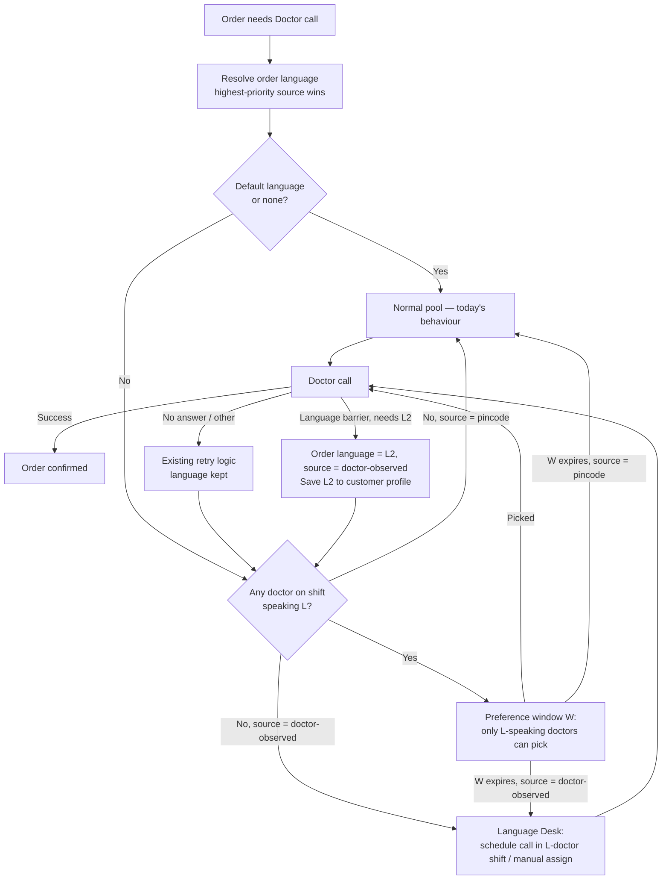

# Project South — Language-Matched Doctor Calls
**Version:** v1 (standalone solution)
**Date:** 2026-09-29
**Owner:** Swapnil Singh
**Status:** SUPERSEDED by `project-south-solution-v2.md` (narration Entry 7). This version relied on items that are now future scope: knowing the customer's language and hand-over / instant recovery.

---

## 1. Problem
Some Doctor-call orders drop off or get discarded because the doctor and the customer don't share a language. The call connects, but the consultation can't happen.

Today this failure is **invisible in the data**. The system only tracks calls that don't connect (e.g. no answer). A call that connects but fails because of language ends up as a hold, cancellation or discard with no reason recorded. So we can't yet say how big the problem is.

## 2. Goal and non-goals
**Goal:** Get as many Doctor calls as possible handled by a doctor who speaks the customer's language, **without** making orders wait longer or get stuck.

**Non-goals (v1):**
- Building a new assignment engine. Language is added to the existing one.
- Translating or interpreting calls (possible in Phase 3 for rare languages).
- Changing the customer app in Phases 1–2.

## 3. Design principles
1. **Language is a preference, not a blocker.** A matched doctor is tried first, but only for a limited time. An order is never left waiting indefinitely for a matched doctor.
2. **Measure and correct before predicting.** Record language failures first. That record sizes the problem and fixes repeat failures.
3. **The routing doesn't care where the language came from.** It takes one input, the order language. Sources (pincode, doctor observation, customer choice) plug in and are ranked by how reliable they are.
4. **A doctor can speak several languages.** Every language a doctor speaks widens the pool for that language.
5. **Every order carries its language, the source, and a confidence level.** Anyone can see why an order was routed the way it was.

## 4. Solution overview
Each Doctor-call order gets a **resolved language**, taken from the most reliable source available. If that language is a default language (Hindi/English), or none could be resolved, the order goes to the normal pool as it does today. Otherwise, doctors who speak that language get **first claim for a limited window**. If none is available in time, the order falls back to the normal pool.

If a call still fails because of language, the doctor marks it **"Language barrier — needs [language]"**. The next attempt then goes to a doctor who speaks that language, and the customer's language is saved for future orders.

## 5. Building blocks

### 5.1 Doctor languages
- Each doctor can have **multiple languages**. Store them as a doctor-to-language list, not a single field.
- Language capture is **mandatory at onboarding**. Existing doctors fill it in once as a backfill.
- Only Super Doctor/Admin can edit a doctor's languages.
- *Later:* track a per doctor, per language barrier rate. This catches doctors whose declared language doesn't hold up on calls.

### 5.2 Order language (new fields on the order)
| Field | Values |
|---|---|
| `order_language` | the language code, or null |
| `language_source` | `doctor_observed` / `customer_selected` / `customer_history` / `pincode` / `none` |
| `language_confidence` | high / medium / low (derived from the source) |

**Source priority (highest wins):**
1. **Doctor-observed on this order.** A doctor marked "Language barrier — needs L" on this order. Confidence: high.
2. **Customer-selected.** The customer picked a language in the app or IVR (Phase 3). Confidence: high.
3. **Customer history.** The language saved on the customer from a past barrier tag. Confidence: high.
4. **Pincode.** From the pincode → language table, used only if the pincode passes the confidence threshold. Confidence: medium.
5. **None.** The order goes to the normal pool.

### 5.3 Customer language memory
- Stored on the customer: `preferred_language`, where it came from, and when it was last updated. The most recent value wins.
- It's written whenever a barrier tag is recorded or the customer picks a language.
- This means a customer is mismatched at most once. Every later order routes correctly.

### 5.4 Pincode → language table
- Columns: `pincode`, `language`, `rank`, `share` (estimated % of speakers), `source`, `last_reviewed`.
- **Seeded** from public language/census data and **corrected** using barrier tags aggregated per pincode.
- **Threshold rule:** pincode routing is used only if the top language's share is at or above a threshold (e.g. 60%). In mixed pincodes, pincode routing is skipped, because routing on a wrong guess is worse than not routing.
- Reviewed monthly. If barrier tags in a pincode keep pointing to a different language, the pincode is flagged for correction.

### 5.5 "Language barrier" call outcome on the Doctor Portal
- A new call outcome. The doctor has to pick the language the customer needs from a dropdown.
- **It doesn't use up the customer's no-answer retry count**, because the customer did answer and the failure wasn't theirs.
- Once recorded, it updates the order language (§5.2) and the customer's saved language (§5.3), then sends the order back to routing.

### 5.6 Language Desk (queue for Super Doctor / Ops)
Orders land here when a **known** language need can't be met in time. From here, Ops can:
- manually assign a doctor who speaks the language (dropdown filtered by language);
- schedule the call at the start of that language's next doctor shift, and tell the customer when to expect it ("Our doctor who speaks Tamil will call you between 9–10 am");
- *Phase 3:* bring in an interpreter.

## 6. Routing rules
1. **Resolve the language** when the order becomes ready for a Doctor call (§5.2).
2. **Default or none** → normal pool. No change from today.
3. **Check if anyone is on shift.** If no doctor who speaks L is on shift:
   - pincode-sourced → go straight to the normal pool without waiting (waiting for nobody helps no one);
   - doctor-observed or customer-sourced → Language Desk.
4. **Preference window W.** Only doctors who speak L can pick the order. For a multilingual doctor, orders in their languages come before other orders in their queue.
5. **Window expires:**
   - pincode-sourced → release to the normal pool. The language tag stays visible.
   - doctor-observed or customer-sourced → Language Desk, because a doctor who doesn't speak L is known to fail.
6. **SLA guard.** If an order is close to breaching its promised call time, it's released to the normal pool (pincode-sourced) or moved up the queue (known language need).
7. **Barrier on a call** → §5.5, then back to step 3.
8. **Second barrier on the same order** even with a doctor who speaks L → Language Desk, and that doctor-language pair is flagged for review.

## 7. Stakeholder journeys
| Stakeholder | What changes for them |
|---|---|
| **Customer** | Nothing visible in Phases 1–2. More calls happen in their language. After a mismatch, they don't face another one. If a call gets scheduled, they're told when to expect it. |
| **Doctor** | One-time language declaration. Gets orders in their own languages first. One new call outcome ("Language barrier"). |
| **Super Doctor / Ops** | Edits doctor languages. Works the Language Desk queue. Reviews flagged doctor-language pairs and doctors with unusual barrier-tag rates. |
| **CSR** | Can record a customer's language when the customer calls in. That counts as customer-selected, high confidence. |
| **Doctor supply / hiring** | Gets demand vs supply per language per shift. Uses it to decide which languages to hire for. |
| **Analytics** | Owns the dashboard (§10) and the pilot vs control readout. |
| **Engineering** | New fields and tables (§5), a language filter and priority in assignment, the barrier outcome, the Language Desk queue. No new engine. |

## 8. Edge cases
| Scenario | Behaviour |
|---|---|
| No doctor who speaks L exists at all (rare language) | Language not routed. Treated as none, counted as demand for hiring, and sent to Language Desk if doctor-observed. Phase 3: interpreter. |
| Doctors who speak L exist, but none on shift now (e.g. 9 pm) | Pincode-sourced → normal pool immediately. Known need → Language Desk schedules the call in the next shift and tells the customer. |
| Pincode has several languages | Top language share below threshold → pincode not used. Customer history or the barrier tag handles it. |
| Pincode mapping is wrong | First call may mismatch → barrier tag corrects this customer. Aggregated tags flag the pincode for correction. |
| Customer is comfortable in Hindi/English despite a regional pincode | Harmless: a doctor who speaks L usually also speaks Hindi/English. If not, the barrier tag records Hindi/English as the customer's language. |
| The person answering isn't the patient (e.g. a family member) | The doctor tags the language needed *for this call*. The customer profile stores it. The most recent value wins if it changes. |
| Doctor declares a language but can't really consult in it | A second barrier with a doctor who speaks L flags the doctor-language pair. Super Doctor reviews it. |
| Doctor abuses the barrier tag to skip orders | Track tag rate per doctor against peers. Super Doctor reviews outliers. A language must be picked with every tag. |
| Order near its promised call time | SLA guard (§6.6): release to the normal pool or move it up the queue. |
| Pool for a language is backing up | Alert doctors who speak that language (e.g. every 2h, or when 5+ orders are pending). Surface it on the supply dashboard. |
| Customer's preference changes | The most recent source wins. Customer-selected always beats history. |
| Multilingual doctor in several pools | Sees orders for all their languages first, oldest first across them. |

## 9. Phased rollout
### Phase 1 — Measure and correct (reactive)
Build: doctor languages (§5.1), order language fields (§5.2), customer memory (§5.3), barrier outcome (§5.5), routing for doctor-observed and customer-history sources (§6), Language Desk (§5.6), dashboard (§10).
**Result:** the problem gets sized with real data, and no customer is mismatched twice. It also produces supply-per-language and pincode-correction data.

### Phase 2 — Predict (pincode routing)
Build: the pincode → language table (§5.4), seeded from public data and corrected with Phase 1 barrier tags. Turn on the pincode source in **pilot pincodes, with a control group**, then expand language by language.
**Result:** most mismatches are prevented before the first call.
*This is where the pincode idea sits. It moves after Phase 1 because predictive routing is only safe once we know doctor supply per language and have real mismatch data. If supply data is already solid, Phase 2 can pilot in parallel, since the routing change is the same.*

### Phase 3 — Ask and scale
Customer language selection in the app/IVR (the most accurate source). Language-aware capacity and ETA. Interpreter for rare languages. Language-based hiring plan.

## 10. Metrics
**Primary**
- Dr-call orders lost to a language barrier, as a count and as a % of Dr-call orders (from the barrier tag).
- Discard rate of Dr-call orders, pilot vs control.

**Health**
- Match rate: % of orders with a non-default language handled by a doctor who speaks it.
- Fallback rate: % of orders released to the normal pool after window W.
- Repeat barrier rate: % of orders with a second barrier.
- Language Desk volume and resolution time.

**Guardrails (must not get worse)**
- Time from order to first call attempt.
- Promised-call-time SLA adherence.
- Doctor utilisation per language pool.
- Barrier-tag rate per doctor (abuse check).

## 11. Configuration (all adjustable from the backend)
| Setting | Starting value (to validate) |
|---|---|
| Default languages (no routing needed) | Hindi, English |
| Window W for pincode-sourced orders | 10 min |
| Window W for known language need | 30 min |
| Pincode confidence threshold (top-language share) | 60% |
| Minimum doctors on shift to enable routing for a language | 2 |
| Barriers per order before Language Desk | 2 |
| Pool backlog alert | every 2h, or when 5+ orders are pending |

## 12. Assumptions and open decisions
**Assumptions (not yet confirmed):**
- **A1:** Doctor language data exists today (per Swapnil). Its completeness and table are unconfirmed, and it can be moved to a multi-value list.
- **A2:** The existing assignment logic can take a language filter and priority without a rebuild.
- **A3:** Most doctors speak Hindi and/or English, so these can be treated as default languages.

**Open decisions:**
| # | Decision | Recommendation |
|---|---|---|
| D1 | Phase order: reactive first (Phase 1) or pincode first? | Reactive first. Pincode in parallel only if supply data is solid. |
| D2 | Where does doctor language data live today, how complete is it, and is it single or multi-value? | Confirm with Eng/Data. Move to a multi-value list. |
| D3 | Doctor headcount per language per shift | Needed before Phase 2. Owner: Ops / doctor supply. |
| D4 | Values for W, the pincode threshold and the other §11 settings | Start with §11 values and tune from pilot data. |
| D5 | Source for the pincode → language seed data | Public census language data, corrected with barrier tags. |
| D6 | Customer message when a call is scheduled for a language shift | Needs a comms template (SMS/WhatsApp). |
| D7 | Does a barrier tag use up the customer's retry count? | No (§5.5). Confirm with Ops. |
| D8 | Pilot pincodes/languages and control design | 1–2 languages with high volume and strong doctor supply. |
| D9 | Has any discard root-cause analysis already put a number on language? | Check with Analytics. It changes how this is pitched. |
