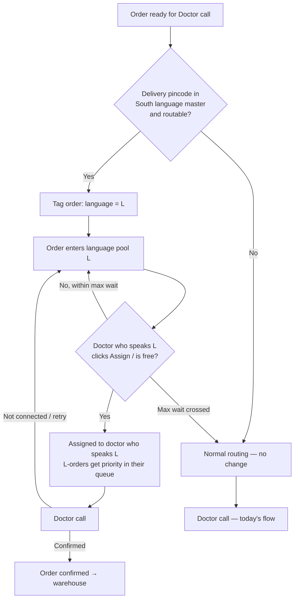

# Project South — Language-Based Doctor Routing for South
**Version:** v2
**Date:** 2026-09-29 (narration Entry 7)
**Owner:** Swapnil Singh
**Status:** Draft solution for review. Supersedes v1.

---

## 1. Problem
Orders from South pincodes (ex-Bangalore) are discarded more often before reaching the warehouse, mainly among first-time customers:

| | South (ex-Blr) | Non-South (ex-Blr) |
|---|---|---|
| FTC discard | 27.83% | 23.40% |
| NFTC discard | 6.31% | 6.49% |

**Hypothesis:** the doctor call fails because the customer and the assigned doctor don't share a language. Doctors are assigned without regard to language, so a Tamil-, Telugu-, Kannada- or Malayalam-speaking customer often gets a doctor they can't consult with.

## 2. Opportunity (Aug data, accepted as the business case)
| Metric | Impact |
|---|---|
| Dr confirm % (South FTC, OP → WH reached) | 72.04% → 76.49% (**+4.46pp**, Non-South parity) |
| Extra confirmed orders | +1,091 / month |
| Extra delivered orders | **+774 / month ≈ +25 / day** |
| OP2OD | +3.16pp South FTC · +0.96pp South all orders |

## 3. Scope
| In scope (this solution) | Future | Not in scope |
|---|---|---|
| Doctors tagged with multiple languages | Knowing the customer's own language (ask, profile, etc.) | Non-voice consultation (chat, questionnaire, translation) |
| Pincode → language mapping for South pincodes | Hand-over / instant recovery after a mismatch | |
| Language-based routing for **all** South Dr-call orders (FTC + NFTC) | Other regional languages beyond South | |
| Supply callout: doctor demand per language | | |

## 4. Solution in one line
**Tag doctors with the languages they speak, map South pincodes to a language, and send each South order to a doctor who speaks that pincode's language.**

---

## 5. Components

### 5.1 Doctor language tagging
- Each doctor can have **one or more languages**, e.g. {Tamil, English, Hindi}. Stored as a doctor-to-language list, not a single value.
- **Backfill:** move today's doctor language attribute into this list. Fill gaps with a one-time doctor declaration.
- **Onboarding:** language becomes a mandatory field for new doctors.
- **Editing:** only Super Doctor / Admin can add or remove a doctor's languages.
- **Visible to the doctor** on their profile as read-only "Languages".
- **Rule:** a doctor should be tagged only with languages they can **consult** in (discuss symptoms, dosage and advice), not just chat in.

### 5.2 South pincode → language master
| Column | Description |
|---|---|
| `pincode` | 6-digit pincode |
| `state`, `district` | For review and reporting |
| `language` | Primary language: Tamil / Telugu / Kannada / Malayalam |
| `is_routable` | `false` for mixed or cosmopolitan areas. These stay on normal routing. |
| `active`, `updated_on`, `updated_by` | Maintenance |

- **Coverage:** South states only (TN, Kerala, AP, Telangana, Karnataka).
- **Default mapping:** by state, overridden by district where needed (e.g. border districts).
- **Not routed (`is_routable = false`):** Bangalore, plus other mixed cities to be decided (D1).
- Stored in the DB, editable from the backend, visible in Metabase.

### 5.3 Order language tag
- When an order **enters the doctor pool**, the system looks up the order's **delivery pincode** in the master:
  - found and routable → stamp `order_language = L`;
  - otherwise → no tag, normal routing.
- The lookup happens at pool entry, not at order placement, so an address change before the doctor stage is picked up.
- The tag stays on the order through every retry.

### 5.4 Assignment rules
1. **Language pool:** a language-tagged order can be assigned only to doctors who speak L, until the max wait is crossed.
2. **Priority for multilingual doctors:** when a doctor who speaks L asks for an order, the **oldest L-tagged order comes first**, before normal orders. This protects the scarce language pools, because most doctors can take Hindi/English orders but few can take Tamil.
3. **Retries:** if a call doesn't connect, the order goes back to the **same language pool**, not the normal pool.
4. **Max-wait safety net:** if no doctor who speaks L picks the order within **X hours** (configurable, D2), it's released to normal routing. The language tag stays visible, so a doctor who speaks L can still pick it if one comes online. This way no order is ever stuck.
5. **Off-shift:** if the order arrives when no doctor who speaks L is on shift, it waits for the next shift, subject to the same max wait. Time isn't the blocker, so waiting is acceptable.
6. **Manual assign (Super Doctor):** the doctor dropdown is filtered to doctors who speak L. Assigning to someone else is allowed but needs a reason, so it can be tracked.
7. **Capacity / ETA:** if the current assignment uses a doctor-capacity or ETA calculation, language-tagged orders should count **only the capacity of doctors who speak L** (D6).

### 5.5 Doctor Portal changes
| Who | Change |
|---|---|
| Doctor | Profile shows "Languages" (read-only) |
| Doctor | Order list and order screen show a **language tag** (e.g. "Tamil") on routed orders |
| Doctor | Orders in their language appear first when they click "Assign" / open their queue |
| Doctor | **Alerts:** doctors who speak L get an SMS/WhatsApp when the L pool has pending orders (e.g. every 2h, or when 5+ are pending) |
| Super Doctor / Admin | Add or edit doctor languages |
| Super Doctor / Admin | Manual assign with a language-filtered doctor dropdown and an override reason |
| Super Doctor / Admin | Language pool view: pending orders per language, oldest wait, doctors online per language |

### 5.6 Supply callout (future demand planning)
**Demand**
- South orders ≈ **80,300 / month (~2,590 / day)**: 24,484 FTC + 55,839 NFTC.
- The Dr-call share and the split by language and hour both come from pincode order trends.

**Supply**
- Doctors per language × shift, and calls each doctor completes per hour.

**Output: a gap table per language × shift**
- Required doctors = Dr-call orders (L, shift) ÷ calls per doctor per shift.
- Compare with current doctors.
- Flag the shortfall for rostering or hiring.

**Go-live gate per language:** at least N doctors who speak L on every shift (N configurable) before that language is switched on. Languages that don't pass the gate stay on normal routing until supply is in place.

---

## 6. Stakeholder view
| Stakeholder | What changes |
|---|---|
| **Customer (South)** | Nothing visible. Gets a doctor who speaks their language more often. May wait a little longer when no doctor who speaks it is free. |
| **Doctor** | Declares languages. Sees language tags. Gets orders in their language first. Gets pool alerts. |
| **Super Doctor / Ops** | Maintains doctor languages. Monitors language pools. Manually assigns when needed. Rosters regional doctors across shifts. |
| **Doctor supply / hiring** | Uses the gap table to recruit or roster per language. |
| **Engineering** | Doctor-language list, pincode master, order language tag, pool and priority rules, portal changes, alerts. |
| **Analytics** | Pilot vs control setup, dashboard, impact readout. |

## 7. Edge cases
| Scenario | Behaviour |
|---|---|
| Pincode not in master, or marked not routable (mixed city) | Normal routing |
| No doctor who speaks L is on shift | Order waits in the L pool until the next shift, subject to max wait, then normal routing |
| L pool is backing up | Alerts to doctors who speak L. Ops can roster more. Max wait releases orders if needed. |
| Doctor speaks several South languages | Belongs to every pool they speak, oldest first across their languages |
| Doctor who speaks L is also needed for Hindi/English orders | L orders come first for them. Non-South volume is served by Hindi/English doctors as today. |
| Customer in a South pincode doesn't speak the local language (e.g. migrant in Chennai) | Accepted risk for now. Doctors who speak L usually also speak English/Hindi. Fixed properly when "customer's own language" moves in from future scope. |
| Call not connected | Retry stays in the L pool |
| Doctor tagged with a language they can't consult in | Watch confirm % per doctor on L orders. Super Doctor reviews and corrects. |
| Delivery address changed before the doctor stage | Language is resolved at pool entry, so the new pincode applies |
| Super Doctor needs to force-assign | Allowed, with a reason; tracked |
| New doctor joins | Language is mandatory at onboarding |

## 8. Rollout
| Phase | What | Exit criteria |
|---|---|---|
| **0. Readiness** | Backfill doctor languages. Build the South pincode master. Supply check per language × shift. Decide the mixed-city list. | Every pilot language passes the go-live gate |
| **1. Pilot** | Turn on routing for **one language/state** with a **control group**: order-level 50/50 split within the same pincodes, to avoid comparing different geographies | Dr confirm % uplift significant vs control; guardrails hold |
| **2. South rollout** | Remaining South languages, one at a time, each through the go-live gate | South FTC Dr confirm % moving towards 76.49% |
| **3. Future** | Customer's own language, hand-over after a mismatch, other regional languages (Bengali, Marathi, Gujarati, Odia…) | Separate scoping |

## 9. Metrics
| Type | Metric | Target / watch |
|---|---|---|
| **Primary** | South Dr confirm % (OP → WH reached), FTC | 72.04% → 76.49% |
| **Primary** | South OP2OD | +3.16pp FTC, +0.96pp all |
| Secondary | South NFTC Dr confirm % | No drop (already at parity) |
| Health | Language match rate: % of routed orders confirmed by a doctor who speaks L | High, rising |
| Health | Max-wait release rate: % of routed orders sent back to normal routing | Low. A high rate means supply is short. |
| Health | Time from pool entry to first call, routed vs control | Watch. Time isn't the blocker, but track it. |
| **Guardrail** | Non-South Dr confirm % and time to first call | No drop (checks that prioritising multilingual doctors doesn't hurt others) |
| **Guardrail** | South cancellation % (FTC 11.88%, NFTC 7.25%) | No rise. Recovered orders shouldn't just turn into cancellations. |

## 10. Configuration
| Setting | Starting value (to validate) |
|---|---|
| Active languages / states | Pilot language only, then expand |
| Max wait before release to normal routing | X hours (D2) |
| Minimum doctors per shift for a language to go live | N (D5) |
| Pool alert | every 2h, or when 5+ orders are pending |
| Pilot split | 50% routed / 50% control |
| Mixed cities (not routed) | Bangalore + list from D1 |

## 11. Open decisions
| # | Decision | Recommendation |
|---|---|---|
| D1 | Which mixed cities to exclude besides Bangalore (Hyderabad, Chennai, Kochi?) | Exclude Hyderabad; pilot Chennai with routing on and watch it |
| D2 | Max wait before releasing to normal routing | Start at 4h, or the next shift start if no doctor who speaks L is online |
| D3 | Pilot language/state | Highest South volume with enough doctors who speak the language on every shift |
| D4 | Where does the doctor language attribute live today, and how complete is it? | Confirm with Eng/Data. Migrate to a multi-value list. |
| D5 | Minimum doctors per shift for go-live | From the supply check. Start with 2. |
| D6 | Does current assignment use a capacity/ETA calculation that needs a language filter? | Confirm with Eng |
| D7 | Should the customer ETA change for routed orders? | No change in the pilot; revisit if wait time grows |
| D8 | Strict priority for L orders vs a weighted mix for multilingual doctors | Strict priority for the pilot |
