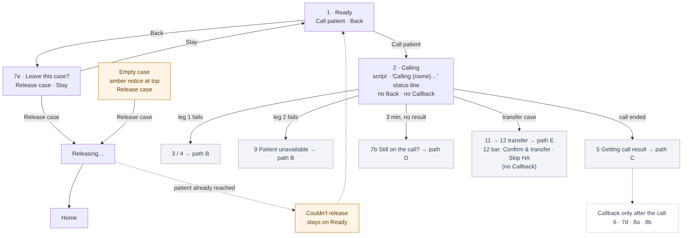

# Calling walkthrough review — 2026-11-02

**What this is:** Apurva's misses from the calling walkthrough (`docs/renders/2026-10-26-margin-16/WALKTHROUGH.html`), reviewed path by path against `ui-screens/app-logic.md` §4–§7 and D-58, D-74–D-81.
**Rule:** decisions only. Nothing here is applied to `app-logic.md`, `ui-screens/`, `messages.json`, `feedback-state-map.md` or the design system until the running fix round (Round 6 as of 2026-11-03) is merged; then everything is applied in one pass (list at the end of each path) and recorded in the decision log. Before applying, every item is re-checked against the merged fix round, since later rounds may have changed the same states.
**Buckets:** (1) drawing error — picture wrong, rule right · (2) already fixed — a later decision covers it, the page lags · (3) real logic gap — decided here.
**Reference:** `walkthrough-reference.html` (the walkthrough with pictures embedded; pictures from 26 Oct, styling stale).

| Path | Status |
|---|---|
| A · Start and the call | **Closed 2026-11-02** |
| B · Doesn't connect | **Closed 2026-11-02** |
| C · The gate | **Closed 2026-11-03** |
| D · No result | **Closed 2026-11-03** |
| E · Transfer | **Closed 2026-11-03** |
| F · Fallback B | **Closed 2026-11-03** |

---

## Path A · Start and the call — closed 2026-11-02

### Final flow

**1 · Ready** (`t01`) — Order details + View Rx, medicines, notes; no script. Bar: **Call patient**. Header **Back** → 7e "Leave this case?": **Release case** → Releasing… → **Home**; Stay → back to Ready. If the patient was already reached, the release is refused ("Couldn't release this case. You're still on it.") and the doctor stays on Ready.

**Empty case** (`a-no-medicines`) — no Call patient. **Amber notice at the top of the panel** (standing state): "This order has no medicines. Release it — our Ops team will check it." Main button **Release case** → Releasing… → Home. No sheet.

**2 · Calling** (`t02` / `s7a`; transfer `t11`) — from the tap: header Back hidden for the rest of the case; phone back → toast "Finish this case first…". End-of-call script under Order details. Bar: status line **"Calling {name}…"** only — **no Callback**. Exits: leg 1 fails → 3 / 4 (path B) · leg 2 fails → 9 (path B) · call ended → 5 (path C) · 3 min with no result → 7b (path D) · transfer case, gate passed → 12 (path E).

**Callback** — appears only once the call is over: **6, 7d, 8a, 8b**.

### Decisions

**CW-A1 · Callback only after the call** (bucket 3)
- Callback is removed from every live state: 2 / 7a, 11, 12, 17. It shows on 6 Call too short, 7d Result not received, 8a / 8b Valid.
- 12 bar becomes **Confirm & transfer · Skip HA** (Skip HA full width under the main button, as 8a). Skip HA path unchanged (→ 17 → Confirm prescription); 17 shows only the "Getting call result…" status line.
- **Backend guard:** a callback is refused unless the patient answered (leg 2) on this case. Safety-net copy (proposed): "Couldn't schedule a callback. The patient wasn't reached."
- Rule in one line: **during a call the only button is Confirm & transfer (and Skip HA beside it); everything else comes after the call.**
- **Why:** Callback from the tap let a doctor drop a case without speaking to the patient. Mid-call the backend often can't verify (Knowlarity, used for Cat4, sends no live "patient answered" event), and the doctor is on the phone's call screen anyway. After the call the result proves the patient answered.
- **Rejected:** B — keep Callback live and check on tap (would wrongly refuse real Cat4 callbacks); C — live Callback saved as pending and decided by the record (new state, new copy, end-the-call check on more screens); leaving it to Ops monitoring (Apurva: must be a backend rule).
- **Changes:** D-58 pts 18, 24, 25 ("Callback in every live call"); D-75 pt 3 (callback sheets no longer open over Calling); app-logic §5 rule and §7 "Available while on call".

**CW-A2 · 7d unchanged** — Confirm prescription · Callback + Unavailable. Callback on 7d is judged by the call record, as Confirm is on 7f: record shows the patient didn't answer → Patient unavailable; no record → Ops review queue (OQ-033).

**CW-A3 · 16 Ended before the transfer keeps no Callback** — the patient was consulted past the gate; Confirm & forward · Skip HA.

**CW-A4 · Request next case during a live call — closed by CW-A1** — a callback can no longer close a case while the call is live. The end-the-call check (15b) stays only on 15 and B3. **14 Transferred needs no check:** the doctor is dropped from the call automatically once the Health Advisor's phone starts ringing.

**CW-A5 · After Release the doctor goes to Home** — add to app-logic §4.

**CW-A6 · Empty case: amber notice at the top, no sheet** (bucket 3)
- The plain text in the medicines card becomes an **amber notice at the top of the panel** (notice placement rule, backlog §2h: standing states at the top, action results in the bar). Copy: "This order has no medicines. Release it — our Ops team will check it."
- **Release case** releases directly → Releasing… → Home.
- **Rejected:** notice in the pinned bar (the bar is for action results — would break the rule agreed today); a confirmation sheet (only one way out; repeats the notice).
- **Open, backlog:** where a released empty case really goes (OQ-035) is an open product point; "our Ops team will check it" is a placeholder until then.

**Already decided, text lags (bucket 2)**
- app-logic §5 row 7e: "Back in 1–4, 7a, 7b" → **1, 3, 4** (D-80). §4 "Leaving a case" paragraph: broken parenthesis / double full stop.
- Walkthrough page: 2 Calling shows Back and a busy button (D-74, D-80); arrow "Back before patient answers → 7e" from Calling is outdated (D-80).

**Carried to path E**
- 15 can only happen when the transfer can't start (no Health Advisor free, or the transfer request fails) — the doctor is still on the line. "The Health Advisor didn't pick up" is not the doctor's state: the doctor is already dropped and sees 14. The walkthrough's "no HA joined" label for 15 needs a decision there.
- Knowledge (for `knowledge/context/`, filed in the apply pass): on a transfer the doctor's leg drops once the HA's phone starts ringing; if the HA doesn't pick up, the order stays partially digitised and an agent calls the patient back.

### Apply pass for path A (after the fix round is merged)
- **app-logic:** §4 stage table (Calling bar, Transfer ready bar, Release → Home, empty case notice); §4 Leaving-a-case paragraph fix; §5 Callback rule + rows 2, 7e, 11, 12, 17; §7 Callback availability + backend refusal.
- **messages.json / feedback-state-map:** callback-refused message; empty-case notice copy.
- **Pictures:** t02, s7a, t11, t12, t17, callback sheets (now over a post-call state, e.g. 6), a-no-medicines.
- **Walkthrough page + flow diagram:** regenerate from current `ui-screens/` pictures.
- **Decision log:** record CW-A1–A6 as one entry. **Engineering (backlog §4):** backend refuses a callback without leg 2 answered.

---

## Path B · Call doesn't connect — closed 2026-11-02

### Final flow

**3 · Didn't go through** (`t03`) — our call request failed on the **doctor's / system side** (partner refused the request for a reason that isn't the patient's number, or a leg-1 network / partner error). No script. Red notice band in the bar "Call didn't go through." · **Call again** · header **Back** (leave sheet → Release allowed after 3, D-80). Not an attempted call; no talk time; no Callback (patient never reached, CW-A1); no Unavailable; no retry limit — Help if it keeps failing.

**4 · You didn't answer** (`t04`) — the doctor's own phone (leg 1) didn't answer, was busy or rejected. Same as 3 with an amber band "You didn't answer the call." · **Call again** · header Back.

**9 · Patient unavailable (automatic)** (`t09`) — the doctor answered, then the patient's side failed (no answer, busy, rejected, switched off / unreachable, invalid number). The case closes by itself on that try. Grey card "Patient unavailable"; medicines keep their status. **The case goes on hold and the system retries it** (CW-B2); the partner's reason is saved because it decides the retry. Bar: **Request next case** · Back to Home (the call has ended — no end-the-call check).

### Decisions

**CW-B1 · 3 and 4 are only for the doctor's side** (bucket 3)
- **Rule:** 3 / 4 cover failures on the doctor's side only. **Anything caused by the patient or the patient's number goes to 9, whenever it is detected** — including a partner refusing the request up front because the patient's number is invalid.
- **Why:** app-logic maps 3 to "request refused", so an invalid patient number rejected at the request would land on 3 — Call again forever, or a Release that hands the same failure to the next doctor.
- **Changes:** app-logic §5 rule "Leg 2 failed" and rows 3 / 9 (triggers); Engineering's hangup-cause mapping.

**CW-B2 · Patient unavailable = hold, retried by the system** (bucket 3; backend rule, no screen change)
- Nothing goes to Ops. The case goes on **hold** and the system retries it, by the partner's hangup cause — same pattern as the Ring AI PRD §6:
  - busy / no answer / switched off / temporary network error → hold, retried after a gap (starting values from Ring AI: 30, then 60, then 60 min; 4 attempts);
  - **unknown or missing hangup cause → plain hold**;
  - **invalid / wrong number → not retried**, flagged for data cleanup.
- Gaps and attempt count are **settings for doctor cases**, separate from Ring AI's; the hangup-cause list maps to these actions in config (Engineering).
- The 2-min quick retry does not apply here: a connected call that drops quickly is state 6, where the doctor taps Call again.
- **Why:** one rule for a patient who couldn't be reached, handled by the system; retrying a wrong number just repeats the failure for the next doctor.
- **Rejected:** sending unavailable cases to Ops; retrying invalid numbers.
- **Changes:** app-logic §7 Flag 6 wording ("goes back to the queue") and D-80 pt 2 ("216 ORDER ON HOLD") — both read as: hold, then retried by the system. Answers the project's must-ask "No-pickup handling" (attempts / hold duration) as settings.

**CW-B3 · Pictures 3 and 4 — no change** — the current `ui-screens/case/t03`, `t04` already show header Back, the notice band in the bar and Call again (D-80, fix round). Only the walkthrough's 26 Oct copies lag (bucket 2).

**Cross-check with path A:** consistent — no Callback on 3 / 4 (CW-A1); Back on 3 / 4 and Release → Home (CW-A5).

### Apply pass for path B (after the fix round is merged)
- **app-logic:** §5 Leg-2 rule + rows 3 / 9 (doctor-side vs patient-side triggers); §7 Patient unavailable → hold and system retry (by hangup cause; invalid number not retried); Flag 6 wording; §12 / open questions: retry settings for doctor cases.
- **Pictures:** none (t09 card unchanged).
- **Decision log:** record CW-B1–B2 with path A's entry. **Engineering (backlog §4):** hangup-cause mapping (patient-side → 9) and the hold / retry settings for doctor cases.

---

## Path C · The gate — closed 2026-11-03

### Final flow

**5 · Getting call result** (`t05`) — the partner reported the call ended; the result isn't in yet (normally seconds). No script, no Back. Bar: status line "Getting call result…" only — **no Callback** (CW-C1). Only where the partner sends a call-ended event (CW-C2). No result within 3 min of the tap → 7b (path D).

**6 · Call too short** (`t06`) — total talk time on the case under the gate (setting, today 50 s; calls ≥ ~10 s within ~30 min add up; count never shown). Amber band "Call too short to write a prescription. Call again to continue." No script, no Back. Bar: **Call again** · Callback. Call again → 2 Calling; talk time keeps adding.

**8a · Valid** (Cat4 / HA skipped) — Bar: **Confirm prescription** only (CW-C3). Confirm → Confirming… → 10a. Failure → "Couldn't confirm. Nothing was lost."; no server answer → stays Confirming… while it checks, never a second submit.

**8b · Valid** (Pilot Non-Value Meds) — Bar: **Confirm & forward** · Skip HA (CW-C3). Skip HA → reason → Confirm prescription → 10a. Confirm & forward → 10b.

**8c · Confirm blocked** — any confirm tapped with a Pending medicine: red band "Prescribe or disable {n} medicines first.", scroll to the first Pending, button stays tappable. All medicines disabled → Confirm allowed (D-59).

**10a / 10b · Closed** — green card under Order details ("Prescription confirmed" / "Forwarded to Health Advisor"); rows read-only, no arrows; View Rx outlined; **Request next case** · Back to Home (only Back to Home if availability ended). Current pictures checked — no change.

### Decisions

**CW-C1 · No Callback on 5** (follows CW-A1) — before the result there's no proof the patient answered.

**CW-C2 · When 5 can happen** (bucket 3 — clarity)
- 5 = the partner told us the call ended, result not in yet. It needs a separate call-ended event:
  - **Pilot (Ozonetel, live events):** yes — after the hang-up event until the result. Same after Skip HA on a live transfer (17 shows the same status line).
  - **Cat4 (Knowlarity, result only):** no — the app stays on **Calling** until the result arrives, then goes straight to 6 / 8a / 9. If nothing comes, 7b asks at 3 min and "Call ended" → 7c. For Cat4, 7b / 7c are the "call ended" step.
- **Engineering, to log:** does Knowlarity send any call-ended event (if yes, 5 applies to Cat4 too)? Which partner handles Pilot Non-Value Meds (open since D-58 pt 14)?

**CW-C3 · After a valid call: only the confirm button (and Skip HA where it applies)** (bucket 3)
- **Callback removed from 8a and 8b.** Callback now means "the consultation couldn't happen" and shows only on **6 and 7d**. A patient who wants reports or family first says so early (short call → 6, where Callback is). After a valid call the doctor's job is to confirm; a rare callback need goes through Help.
- **No Call again after a valid call in this version.** 8a = Confirm prescription; 8b = Confirm & forward · Skip HA; 16 unchanged = Confirm & forward · Skip HA (CW-A3 stands).
- **Why:** one meaning per button; callback after a valid call is rare and a way to dodge the confirm; Call again for a call that drops after the gate is an edge case (doctors hardly call back today) and would need its own exception and states.
- **Rejected:** Callback on every after-call state incl. 16 (Claude's first proposal); Call again on 8a / 8b / 16 — moved to next version (CW-C4).
- **Changes:** D-58 pts 18, 24; app-logic §4 stage table (Valid row), §5 rows 5, 8a, 8b; §7 "Available … after 50 s".

**CW-C4 · Next version (logged, backlog §4b): Call again after a valid call**
- Idea: Call again as the secondary on 8a, 8b and 16 (16: Confirm & forward stays primary; Call again → 11 → Confirm & transfer as soon as the patient answers), for a call that drops after the gate mid-consultation or before the transfer. Needs a rule that a failed re-call after the gate never closes the case (back to 8a / 8b / 16 with "The patient didn't answer.").
- **Decide with data:** how often connected calls end shortly after the gate for a network reason rather than a normal hang-up (today's call logs). Rare → keep the simple bar; common → add it as drafted.

**Cross-check with paths A and B:** consistent — Callback only after the call and only where the patient answered but couldn't be consulted (CW-A1 narrowed by CW-C3: 6, 7d); 3 / 4 / 9 unchanged (CW-B1); 16 as agreed in CW-A3.

### Apply pass for path C (after the fix round is merged)
- **app-logic:** §4 stage table (Valid row bars); §5 rule list (5 per partner; Callback only on 6 / 7d), rows 5, 8a, 8b; §7 Callback availability.
- **Pictures:** t05, t08a, t08b (+ 360) bars.
- **Backlog §4b:** CW-C4 with its data check. **Engineering (backlog §4):** Knowlarity call-ended event?; partner for Pilot Non-Value Meds.

---

## Path D · No call result — closed 2026-11-03

Mostly Cat4 (Knowlarity — nothing reaches the app until the result); also any case whose result is lost.

### Final flow

**7b · Still on the call?** (`s7b`) — 3 min after the tap with no result (backend timer, repeats every 3 min), **only when the app can't know whether the call ended** (CW-D1). Script stays (the call may be live); no Back; no Callback. Bar: grey "Are you still on the call?" · **Still talking** (→ Calling, asked again in 3 min) + **Call ended** (→ 7c).

**7c · Checking call result** (`s7c`) — status line "Checking call result…" while the backend asks the partner for the record. Record found → its normal outcome (6, 8a, 8b, 9, 3, 4). Nothing → 7d.

**7d · Result not received** (`s7d`) — amber band "We didn't get the call result."; no script, no Back. Bar follows the route (CW-D2):
- Cat4 / HA skipped: **Confirm prescription** · Callback + Unavailable.
- Pilot with an HA call: **Confirm & forward** · Callback + Unavailable (no Skip HA).
- Callback is judged by the record (CW-A2); Unavailable opens the reason sheet and closes the case.

**7f · Waiting for the call record** (`s7f`) — grey card "Waiting for the call record · Your prescription is saved. We'll confirm it once the record arrives." · Request next case · Back to Home. Record over the gate → "Prescription confirmed" (Pilot: forwarded to the HA). Record under the gate or patient never answered → CW-D3. No record within a wait time (setting) → treated like CW-D3 (CW-D4).

### Decisions

**CW-D1 · 7b only when we can't know the call ended** (bucket 3)
- When the partner has already reported the call ended (the app is on 5 — Ozonetel), the 3-min timeout **skips 7b and goes straight to 7c**. 7b ("Are you still on the call?") is only for cases with no call-ended event (Cat4 / Knowlarity).
- **Why:** asking whether the doctor is still on a call we know has ended is a wrong question.
- **Changes:** app-logic §5 row 7b trigger; 5 → 7c at timeout.

**CW-D2 · 7d's main button follows the route** (bucket 3)
- Cat4 / HA skipped → **Confirm prescription**; Pilot with an HA call → **Confirm & forward** (a transfer is no longer possible — the call has ended). Secondaries stay **Callback + Unavailable**; **no Skip HA on 7d** (four actions don't fit the main + two secondaries pattern; 7d is a rare fallback, and a patient who declines can tell the HA).
- 7f for Pilot: once the record confirms, the case is forwarded to the HA.
- **Why:** a generic Confirm on a Pilot case would lose the HA step.
- **Rejected:** Skip HA on 7d (fifth way out on a rare screen); one generic Confirm for all.
- **Changes:** app-logic §5 rows 7d, 7f; §6 final-button table (7d note).

**CW-D3 · A submitted prescription the record doesn't support goes back through hold** (bucket 3)
- Record shows total talk time **under the gate**, or the **patient never answered** → the prescription is **not confirmed**; the case goes back through **hold and retry** (CW-B2). **Nothing goes to Ops.** The doctor isn't paid the ₹20; they aren't interrupted mid-case — the prescription just doesn't appear in their earnings.
- **Analytics:** every mismatch between what the doctor did and the record is logged in an analytics table — Call ended / Confirm / Callback / Unavailable on 7d vs the record. Basis for a later doctor trust score and warnings (next version, backlog §4b).
- **Why:** the gate stays real even when the doctor confirms without proof; the system handles it like any unreached patient.
- **Rejected:** a per-doctor Ops flag for "patient never answered" (Apurva: nothing goes to Ops); interrupting the doctor.
- **Changes:** D-58 pt 20 ("a late record showing under 50 s or no answer is to be decided separately") — now decided; D-58 pt 22 total-talk-time rule applies.

**CW-D4 · No record ever arrives → same as CW-D3** (answers OQ-033)
- After a wait time (setting) with no call record, the prescription is **not confirmed** and the case goes back through **hold and retry** (CW-B2). Nothing goes to Ops; no ₹20; logged in the mismatch table.
- **Why:** no record = no proof the gate was met; one rule for every unproven confirm. The patient may get a second doctor call — accepted, rare.
- **Rejected:** Ops review queue (Apurva: nothing goes to Ops); confirming on trust (bypasses the gate).
- **Changes:** D-58 pt 20 / app-logic §5 rule "a record that never arrives goes to the Ops review queue"; walkthrough 7f "after 30 min → Ops review queue".

**Cross-check with A–C:** consistent — no Callback on 7b (CW-A1); 7d keeps Callback (CW-A2, Callback only on 6 / 7d per CW-C3); 7c / 5 per partner (CW-C2); hold and retry as CW-B2.

### Apply pass for path D (after the fix round is merged)
- **app-logic:** §5 rows 5 / 7b (timeout → 7c when the call is known ended), 7d (bar by route), 7f (outcomes incl. CW-D3, CW-D4); §6 note for 7d.
- **messages.json / feedback-state-map:** 7f Pilot wording if needed.
- **Pictures:** new state 7d Pilot (Confirm & forward · Callback + Unavailable); 7f unchanged unless the Pilot wording changes.
- **Backlog:** §4b doctor trust score + warnings (from the mismatch table); Engineering (§4): mismatch analytics table; OQ-033 answered by CW-D4.

---

## Path E · Transfer (Pilot Value Meds, Ozonetel) — closed 2026-11-03

> **Launch note (CW-F1):** B ships first. 11 / 12 (route-labelled Confirm & transfer on the live call) belong to target A, the later version. At launch a Pilot live call uses B1 → B2 (path F); 13, 14, 15, 16, 17 and CW-E1–E3 apply to both.

### Final flow

**11 · Calling, transfer case** (`t11`) — script "I'm writing your prescription now. Please stay on the line — I'll connect you to our Health Advisor."; status line "Calling {name}…"; no Back, no Callback (CW-A1). Exits: doctor's side fails → 3 / 4 · patient's side fails → 9 · call ends before the gate → 5 → 6 · gate time since the patient answered and call live → 12.

**12 · Transfer ready** (`t12`) — script stays. Bar: **Confirm & transfer** · Skip HA (full width). A last check on tap catches a call that ended in between (→ 16).

**13 · Transferring…** (`t13`) — busy; rows read-only and muted; no Callback. HA's phone starts ringing → the doctor is dropped automatically → 14. Transfer can't start → 15.

**14 · Transferred** (`t14`) — green card "Transferred to Health Advisor" · Request next case · Back to Home. No end-call check (doctor already dropped). If the HA doesn't pick up, the order stays partially digitised and an agent calls the patient back — not the doctor's state.

**15 · Health Advisor unavailable** (`t15`) — the transfer couldn't start (no HA free / request failed); the doctor is still on the line (CW-E1). Amber card "Forwarded to Health Advisor · Health Advisor unavailable right now. Read the script, then end the call." + script `call.forwardedTell`; goes as a forward. **While the call is live the bar shows only the status line "Waiting for the call to end…"; once the hang-up is reported, Request next case · Back to Home appear** (CW-E3).

**16 · Ended before the transfer** (`t16` / `t16b` / `t16c`) — hung up after the gate, before the transfer; amber notice naming who ended it; no script. Bar: **Confirm & forward** · Skip HA (CW-A3; Call again is next version, CW-C4).

**17 · Skip HA during the live call** (`t17`) — Skip HA → reason sheet. Grey "Health Advisor call will be skipped."; script stays while live. Bar: status line **"Calling {name}…" until the hang-up, then "Getting call result…"** (CW-E2); no Callback. Result → **Confirm prescription** (8a).

### Decisions

**CW-E1 · 15 = the transfer couldn't start** (bucket 3 — carried from path A)
- 15 happens only when the transfer can't start (no Health Advisor free, or the transfer request fails); the doctor is still on the line. "The HA didn't pick up" is not the doctor's state — the doctor is dropped once the HA's phone rings and sees 14.
- **Changes:** app-logic §5 row 15 trigger ("Transfer failed / none free" → "transfer couldn't start: no HA free or request failed"); §6 transfer-vs-forward paragraph; walkthrough label "no HA joined".

**CW-E2 · 17 waits for the result; message fixed** (bucket 1/3)
- After Skip HA on a live transfer call the bar shows "Calling {name}…" until the partner reports the hang-up, then "Getting call result…", then Confirm prescription on the result. (Today it shows "Getting call result…" while the call is still live.)
- **Why:** the transfer count isn't proof — it starts from Ozonetel's live "patient answered" event, which can arrive late or drift from the real talk time; only the partner's result proves the gate. Confirm & transfer is safe because the transfer itself needs a live call; Confirm prescription after Skip HA has no such check. Matches D-58 pt 4 (non-transfer outcomes unlock on the partner's result).
- **Rejected:** Confirm prescription straight after Skip HA (Claude's first lean — a late or short result could confirm a prescription under the gate).
- **Changes:** app-logic §5 row 17; D-58 pt 14 note.

**CW-E3 · 15: buttons only after the hang-up; 15b retired** (bucket 3)
- On 15, while the call is live, the bar shows only the status line **"Waiting for the call to end…"** — no buttons. When Ozonetel reports the hang-up (~3 s with polling), **Request next case · Back to Home** appear. Safety net: no hang-up event → the 3-min timeout check (CW-D1) runs, then the buttons appear.
- **15b `call.end-call-first` is retired** (no false button, no error after the tap). B3 (path F) gets the same treatment.
- **Why:** prevent the mistake instead of correcting it; path E runs on Ozonetel, which reports the hang-up.
- **Rejected:** keeping Request next case visible with a check on tap (D-63, 15b) — a button that doesn't work yet.
- **Changes:** D-63 (for 15); D-81 F26 ("End the call to get your next case." as an amber warning) no longer needed for 15; app-logic §5 rows 15 / 15b; copy key for "Waiting for the call to end…".

**QE1 agreed; no other changes:** 11, 12 (bar per CW-A1), 13, 14, 16 as above.

**Cross-check with A–D:** consistent — no Callback in live states (CW-A1); 12 = Confirm & transfer · Skip HA (CW-A1); 16 unchanged (CW-A3, CW-C4 next version); 5 / "Getting call result" only after a known hang-up (CW-C2); timeout check as CW-D1.

### Apply pass for path E (after the fix round is merged)
- **app-logic:** §5 rows 15 (trigger, bar while live / after hang-up), 15b (retire), 17 (status line sequence); §6 transfer-vs-forward paragraph (15 trigger; HA not picking up → 14).
- **messages.json / feedback-state-map:** new "Waiting for the call to end…"; retire the 15b line for 15.
- **Pictures:** t15 (bar: status line while live) + new state 15 after hang-up (Request next case · Back to Home); t17 (status line "Calling {name}…"); remove t15b from the set.
- **Knowledge (`knowledge/context/`):** transfer mechanics — doctor dropped when the HA's phone rings; HA no-answer → order stays partially digitised, agent calls back.

---

## Path F · Fallback B — closed 2026-11-03

> **B is the launch version** (CW-F1). HA reservation at call start (target A, OQ-032) comes later.

### Final flow

**B1 · Confirm prescription** (`g1`) — Pilot live call (Ozonetel). Neutral script "…Our Health Advisor will help you with the next steps." Status line "Calling {name}…" until the gate has passed since the patient answered and the call is live; then bar **Confirm prescription** · Skip HA (no Callback, CW-A1). Skip HA → as 17 (CW-E2). Call ends after the gate, before Confirm → **16** Confirm & forward · Skip HA, with the who-ended variants 16 / 16b / 16c (CW-F3).

**B2 · Checking for a Health Advisor…** (`g2`) — status line, no buttons. HA free → 13 Transferring → 14. None free → B3.

**B3 · Forwarded, no HA free** (`g3b`) — amber card "Forwarded to Health Advisor" + script `call.forwardedTell`; doctor still on the line. Bar as 15 (CW-E3): "Waiting for the call to end…" until the hang-up, then Request next case · Back to Home.

### Decisions

**CW-F1 · B ships first; A later** (Apurva)
- The rebuild, PRD and test cases build **B first**. A (route known at call start, route-labelled Confirm & transfer / Confirm & forward on the live call — 11 / 12) stays documented as the later version.
- **Changes:** D-58 pt 15 (A = target, B = documented fallback → B = launch, A = later); app-logic §5 Fallback B paragraph becomes the main Pilot flow; project CLAUDE.md / handoff "next" notes; the rebuild checklist (B states first).

**CW-F2 · A forward is confirmed only on the partner's result** (bucket 3, backend — also applies to path E's 15)
- From 15 and B3 the prescription was confirmed on our own live count, but the patient is forwarded, not transferred — no live-call check proves the gate. The forward is **confirmed only when the partner's result arrives** after the hang-up (as 7f). Result under the gate → CW-D3 (not confirmed, back through hold and retry; no ₹20; logged).
- No screen change — the doctor still sees "Forwarded…" and moves on.
- **Why:** same reasoning as CW-E2 — only the partner's result is proof; a transfer is safe because it needs a live call, a forward isn't.
- **Changes:** app-logic §5 rows 15, B3; §6 transfer-vs-forward paragraph.

**CW-F3 · B1 call ends after the gate, before Confirm → 16** — Confirm & forward · Skip HA, with the who-ended variants (16 doctor / 16b patient / 16c unknown) and their copy. **Copy check (settled 2026-11-03, D-83):** the current doctor line ("You ended the call before the transfer. Next time, stay on the line until the Health Advisor joins. They'll call the patient back.") is true in B too — in B the Health Advisor joins only after Confirm, so "stay on the line until the Health Advisor joins" already covers confirming. One key for A and B; no new copy.

**Cross-check with A–E:** consistent — no Callback on B1 / B2 (CW-A1); Skip HA → 17 behaviour (CW-E2); B3 = 15 (CW-E1, CW-E3); 16 unchanged (CW-A3).

### Apply pass for path F (after the fix round is merged)
- **app-logic:** §5 Fallback B as the launch Pilot flow (B1 bar, B1 → 16, B3 bar per CW-E3); rows 15 / B3 confirmation on the result (CW-F2); §6.
- **messages.json:** B3 uses "Waiting for the call to end…".
- **Pictures:** B1 before the gate (Pilot "Calling {name}…" with the neutral script — new state, B is the launch flow), g1 (Confirm prescription · Skip HA), g2 / t13 greyed row without Callback, g3b (bar per CW-E3) + after-hang-up state.
- **Decision log / docs:** record CW-F1 (launch order) prominently; rebuild checklist puts B first.

---

## Summary for the apply pass and the final audit

**Rules changed (app-logic):** Callback only on 6 and 7d (CW-A1, C1, C3) · backend refuses a callback without leg 2 answered (CW-A1) · Release → Home (CW-A5) · 3 / 4 doctor-side only, patient-side → 9 (CW-B1) · Patient unavailable = hold and system retry by hangup cause (CW-B2) · 5 only after a known hang-up (CW-C2) · 7b skipped when the call is known ended (CW-D1) · 7d bar by route (CW-D2) · unproven confirm → not confirmed, hold and retry (CW-D3, D4) · 15 = transfer couldn't start (CW-E1) · 17 waits for the result (CW-E2) · 15 / B3 buttons after the hang-up (CW-E3) · forward confirmed on the result (CW-F2) · B ships first (CW-F1).

**New states:** empty case with the amber notice (changed `a-no-medicines`) · B1 before the gate (Pilot calling, neutral script) · 7d Pilot (Confirm & forward · Callback + Unavailable) · 15 after hang-up · B3 after hang-up · callback-refused message (copy / state-map row).

**Changed pictures:** t02, s7a, a-back-blocked, t11, t12, t17 (no Callback; 17 status-line sequence) · callback sheets (over a post-call state) · t05, t08a, t08b (bars) · t13, g2 (greyed row: Skip HA only) · t15 (status line while live), g1, g3b.

**Retired:** 15b `call.end-call-first` · Callback on live states, 5, 8a, 8b · "Ops review queue" for missing records.

**New copy:** callback refused · empty-case notice · "Waiting for the call to end…" · 7f Pilot wording if needed.

**Old text to fix (bucket 2):** app-logic row 7e (1, 3, 4) and the §4 parenthesis · walkthrough page (Back / busy button on Calling; 15 "no HA joined").

**Backlog / Engineering:** OQ-035 empty-case destination (open) · hangup-cause mapping and doctor-case retry settings · Knowlarity call-ended event? · partner for Pilot Non-Value Meds · mismatch analytics table · next version: Call again after a valid call (CW-C4), doctor trust score.

**Final audit:** after the apply pass, every touched screen at 360 and 390 against `docs/renders/2026-11-03-calling-round/CHECKLIST.md`.
